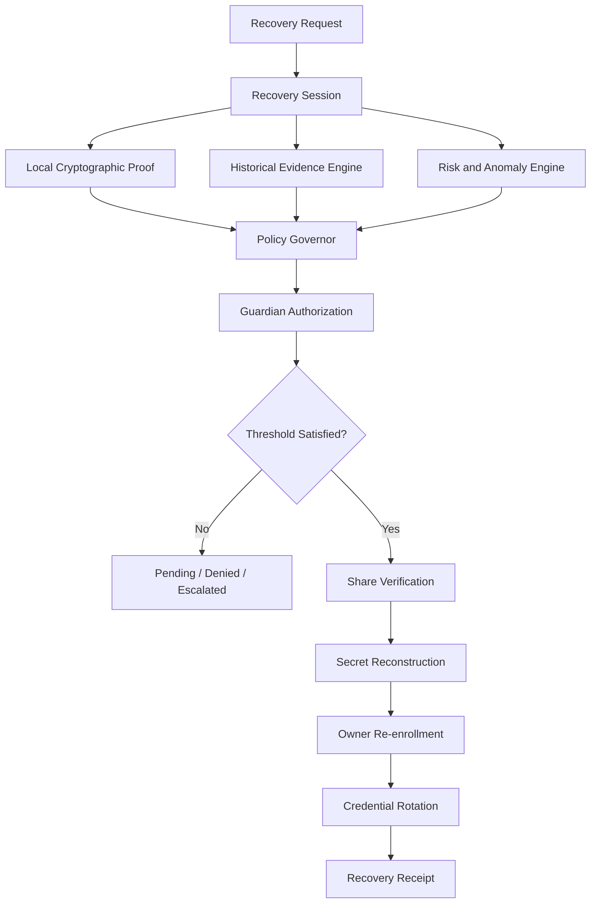
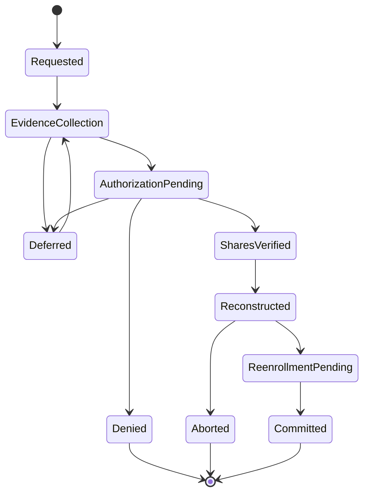

# AdhKey Flailer — RFC: Adversarial Identity Recovery (FINALIZED v1.1)

**Status:** Protocol RFC. P0 crypto audit complete (`FLAILER-CRYPTO-AUDIT.md`); implementation at P1.
**Changelog vs draft:** sections renumbered sequentially (draft jumped 1→6); answer commitments changed to salted memory-hard (D1); root-secret design resolved to random-root + passphrase envelope (D3, was §17 open question); vault AAD binding added (D4); Shamir gap flagged as P1 prerequisite (D2); session-invalidation vs competing-evidence tension resolved with tombstone-and-retain; §13 (was §17) updated — P0 done, next is P1.

## Objective

Recover account control after total device, credential, and session loss without creating an easier path for an attacker to impersonate the owner.

**Design principle:** Recovery is a distributed authorization protocol, not a collection of security questions.

The `adhkey-flailer` crate's existing vault + KDF code is the starting point. **Correction to the draft:** the crate does not yet implement Shamir sharing — the threshold layer must be built in P1 before any threshold claim is testable. No uninspected implementation is assumed to be secure.

## Security invariants

* Recovery must not expose the account's root secret to any single guardian.
* Personal history, writing style, device fingerprints, and location are evidence signals, not cryptographic identity.
* All recovery transitions are explicit, auditable, and fail closed.
* A stolen vault must not enable practical offline guessing of personal answers. *(Enforced by D1: salted, memory-hard answer commitments — never bare SHA256.)*
* Recovery must remain possible when legitimate evidence is missing, stale, or unavailable, provided the required independent authorization threshold is met.
* No successful recovery silently invalidates evidence of a competing recovery attempt. *(Enforced by tombstone-and-retain: completed recovery retires outstanding sessions as tombstoned records; their evidence remains in the audit log.)*
* The root secret is a random 256-bit value, never derived from the passphrase. *(D3 resolution.)*

## 1. System architecture



### Trust boundaries

| Component            | Trust assumption                | Required protection                                            |
| -------------------- | ------------------------------- | -------------------------------------------------------------- |
| Recovery client      | Potentially compromised         | No authority based on client claims alone                      |
| Encrypted vault      | May be stolen                   | Authenticated encryption with AAD (set ID, epoch); minimal metadata |
| Evidence engine      | Evidence may be false or stale  | Provenance, timestamps, confidence, replay defense             |
| Guardian devices     | Some may be compromised         | Independent authentication and share isolation                 |
| Policy governor      | Trusted enforcement boundary    | Deterministic rules, versioned policy, tamper-evident receipts |
| Recovery coordinator | May be malicious or unavailable | Cannot reconstruct the root secret alone; untrusted relay      |
| New device           | Initially untrusted             | Restricted enrollment until recovery commits                   |

The coordinator is a replaceable, untrusted message relay. Cryptographic authorization must not depend on its honesty.

### Key hierarchy (normative, per P0 audit)

```
root: random 256-bit (CSPRNG), never derived from passphrase
  ├─ Shamir 3-of-5 → shares S0..S4 (reviewed impl, e.g. `sharks`; never hand-rolled)
  │    ├─ S0: sealed in passphrase envelope: Argon2id(id)(passphrase, salt) → XChaCha20-Poly1305 → envelope
  │    ├─ S1..S3: guardian-held, each in an authenticated encrypted container bound to guardian ID + epoch
  │    └─ S4: paper backup, high-entropy encoding + checksum + set ID (offline capability, not an identity check)
  └─ vault key = HKDF(root, "flailer-vault-v1" || set_id || epoch)
       └─ XChaCha20-Poly1305(random nonce, AAD = "flailer-vault-v1" || set_id || epoch) → Vault
```

Answer commitments: `commit = Argon2id(answer, per_fact_salt)` with stored `(salt, commit)`. Interactive verification cost is acceptable (human in the loop).

## 2. Supplementary risk signals: web fingerprinting and stylometry

Both belong in a supplementary risk engine. Neither may mint authorization.

### 2.1 Web fingerprinting

Collect only the minimum data needed for the stated purpose. Prefer coarse, short-lived signals over persistent, high-entropy browser fingerprints.

Potential features: previously registered device-key possession; known browser/OS family; previously observed network or region (where lawful and necessary); session timing anomalies; unexpected changes in device capabilities.

Every feature must have a documented purpose, retention period, spoofability assessment, and privacy impact.

Rules:

* A matching fingerprint is not proof of identity.
* A mismatch is not proof of an attack.
* A VPN, browser update, travel, or new device must not automatically block recovery.
* Do not silently increase required cryptographic thresholds based on an opaque model.
* Any policy escalation must be bounded, explainable to the owner, and have an alternate route to recovery.

### 2.2 Stylometry

Objective: detect possible impersonation, not determine identity from writing style.

Pipeline: establish a user-controlled writing baseline during normal, authenticated use; store only the minimum derived representation; version the feature extraction and comparison algorithms; compare recovery-session writing against the baseline accounting for short samples and language changes; emit a confidence interval or uncertainty classification, not a bare identity verdict; pass the result to the governor as supplementary evidence.

The model must explicitly handle: editing assistance and autocomplete; stress, fatigue, unusually short messages; language switching; deliberate imitation and AI-generated text; a baseline contaminated by an attacker; insufficient or outdated samples.

Do not train or update the baseline from an unverified recovery conversation — an attacker could poison the reference model.

### 2.3 Risk-engine output contract

```rust
struct RiskAssessment {
    session_id: RecoverySessionId,
    policy_version: PolicyVersion,
    signal_ids: Vec<SignalId>,
    anomalies: Vec<Anomaly>,
    uncertainty: Uncertainty,
    recommended_action: RiskAction,
}

enum RiskAction { Continue, RequireAdditionalEvidence, HumanReview, Defer, }
```

Advisory output only. The governor independently enforces cryptographic requirements and policy limits.

## 3. Guardian protocol — 3-of-5

Proposed guardian set: A owner-held envelope (passphrase), B mother, C cousin, D boss, E sealed paper backup.

Viable only if the five shares are independently protected — labels do not guarantee independence (guardians may share devices, accounts, addresses, or social-engineering exposure).

### 3.1 Enrollment

Per guardian: unique guardian ID and share index; unique authentication keypair or equivalent strong authenticator; share delivered over a protected channel or stored locally in an authenticated encrypted container; receipt and integrity verified without sending the plaintext share to the coordinator; guardian confirms understanding of the approval procedure; signed enrollment receipt recorded; **a recovery drill is executed before the set is declared active.**

Paper backup: high-entropy encoding with checksum and clear recovery-set identifier, stored separately from other recovery materials; must not include other guardians' shares or the root secret.

### 3.2 Recovery request

Fresh session ID + cryptographically random nonce. Contains: recovery-set ID and epoch; session ID and nonce; protocol and policy versions; creation and expiry timestamps; requested operation; digest of the recovery transcript if one exists. Must NOT contain the root secret, plaintext shares, raw personal answers, or unnecessary timeline details.

### 3.3 Guardian approval

Each guardian independently: authenticates with their enrolled credential; sees a clear, minimal description of the request; confirms session ID and requested action; approves or denies; signs a domain-separated approval statement tied to session, nonce, epoch, expiry, and policy version; receives a receipt confirming the recorded decision.

An approval for one session is never reusable in another. A denial must not reveal whether the guardian possesses a valid share.

### 3.4 Threshold semantics

* Cryptographic threshold: three valid shares reconstruct the secret.
* Human authorization threshold: policy requires two independent guardian approvals.
* These are separate constraints. A guardian approval is not a Shamir share; three shares must not bypass the human-authorization policy where enforceable.
* The paper share is an offline recovery capability, not a human identity check. If it participates in a two-guardian approval policy, the policy must define how an offline share pairs with independently authenticated authorization.

### 3.5 Guardian compromise and replacement

One compromised guardian must not expose the root secret. Revocation stops future use of that guardian's share. Replacement creates a new epoch and re-shares the secret under the new set; old shares are retired and old encrypted containers invalidated. If the root itself may have been exposed, rotate the root and re-encrypt dependent material. An unavailable guardian is never silently treated as approving. Death, coercion, or compromise follow documented exceptional-recovery rules.

**Shamir sharing alone cannot revoke a copied share.** Revocation requires re-sharing and distributing a new share set.

## 4. State machine and failure semantics



### State definitions

| State                | Permitted actions                         | Forbidden actions                             |
| -------------------- | ----------------------------------------- | --------------------------------------------- |
| Requested            | Create session; validate protocol version | Release shares                                |
| EvidenceCollection   | Collect and assess evidence               | Modify the recovery root                      |
| AuthorizationPending | Collect session-bound guardian approvals  | Reuse stale approvals                         |
| SharesVerified       | Validate share integrity and threshold    | Expose root material to the coordinator       |
| Reconstructed        | Perform authorized recovery operations    | Issue unrestricted credentials                |
| ReenrollmentPending  | Bind new credentials and rotate old ones  | Grant ordinary access prematurely             |
| Committed            | Issue final receipt; close session        | Reopen the same session for new authorization |
| Deferred             | Accept new evidence under explicit rules  | Bypass unmet thresholds                       |
| Denied               | Emit minimal denial receipt               | Reveal which answer or share failed           |
| Aborted              | Destroy temporary material where possible | Commit partial credential changes             |

### State-transition invariants

* Every transition is authenticated, authorized, and recorded.
* Each state change includes previous state, next state, session ID, policy version, and transition reason.
* State updates are atomic where supported.
* Duplicate requests are idempotent or explicitly rejected.
* A stale session cannot commit after its epoch is revoked.
* Expiry cannot be extended indefinitely by replaying old evidence.
* Failed recovery does not permanently lock the owner out.
* **A completed recovery tombstones outstanding sessions (retired, evidence retained) and rotates the appropriate credentials — it never silently deletes evidence of competing attempts.**
* Recovery notifications go through pre-enrolled channels, not channels added during the attempt.

NIST's current digital identity guidance treats account recovery as a distinct security process and calls for notification when recovery occurs — an appropriate baseline for Flailer.

## 5. Data model and persistent records

Typed Rust domain objects, explicit versioning; transport schemas separate from domain types and cryptographic serialization.

| Entity            | Required fields                                                             |
| ----------------- | --------------------------------------------------------------------------- |
| RecoverySet       | Owner ID, set ID, epoch, threshold, guardian count, suite ID, status        |
| Guardian          | Guardian ID, share index, authentication-key ID, status, enrollment receipt |
| RecoverySession   | Session ID, owner ID, set epoch, nonce, state, timestamps, policy version   |
| EvidenceRecord    | Evidence ID, provenance, integrity state, timestamps, retention policy      |
| Challenge         | Challenge ID, session ID, source fact IDs, expiry, attempt state            |
| GuardianApproval  | Guardian ID, session ID, signed statement, decision, timestamp              |
| ShareReceipt      | Share index, set ID, epoch, integrity status; never the plaintext share     |
| RecoveryReceipt   | Session ID, outcome, policy version, event-chain digest, signature          |
| CredentialBinding | Credential ID, public-key fingerprint, binding epoch, status                |

Opaque, nonsequential IDs for externally visible records where enumeration is a concern.

Storage boundaries: vault store (encrypted facts + protected metadata); evidence store (provenance-bearing timeline records, location minimized); guardian store (public auth keys, share IDs, signed approvals); session store (transitions, expiry, retry counters, idempotency keys); receipt store (tamper-evident audit events); secret memory (transient reconstruction material, never persisted in ordinary application state).

The data model must distinguish a record's authenticity from its truth — a correctly authenticated GPS sample can still describe a device not held by the owner.

## 6. Rust crate architecture

Cryptographic core stays independent of UI, storage providers, and network transports.

```text
adhkey-flailer/
├── crates/
│   ├── flailer-domain/      ids, evidence, recovery_state, policy
│   ├── flailer-crypto/      vault, key_hierarchy, secret_sharing, passphrase, signatures
│   ├── flailer-evidence/    timeline, provenance, challenge, risk
│   ├── flailer-guardians/   enrollment, approval, threshold, revocation
│   ├── flailer-governor/    transitions, authorization, invariants
│   ├── flailer-store/       traits, encrypted_store
│   ├── flailer-receipts/    event, verification
│   └── flailer-cli/         main
└── tests/
    ├── crypto_properties.rs
    ├── recovery_adversarial.rs
    ├── guardian_collusion.rs
    ├── state_machine.rs
    └── fixtures/
```

Proposed modular boundary, not a crate-per-file mandate; preserve existing boundaries where they already enforce the separation.

### Required interfaces

```rust
trait Vault {
    type Error;
    fn seal(&self, record: &VaultRecord) -> Result<SealedRecord, Self::Error>;
    fn open(&self, record: &SealedRecord) -> Result<VaultRecord, Self::Error>;
}
trait EvidenceProvider {
    type Error;
    fn query(&self, request: &EvidenceQuery) -> Result<Vec<EvidenceRecord>, Self::Error>;
}
trait GuardianVerifier {
    type Error;
    fn verify_approval(&self, request: &ApprovalRequest, approval: &GuardianApproval)
        -> Result<VerifiedApproval, Self::Error>;
}
trait RecoveryGovernor {
    type Error;
    fn evaluate(&self, session: &RecoverySession, evidence: &[EvidenceAssessment],
                approvals: &[VerifiedApproval]) -> Result<TransitionDecision, Self::Error>;
}
```

Illustrative — implementations must enforce authorization inside the trusted boundary, not rely on caller convention.

### Design constraints

* No network/UI dependency in `flailer-crypto`.
* No plaintext secrets in `Debug`, `Display`, or derived serialization (test-gated).
* No blanket `unwrap()` on attacker-controlled inputs.
* No default-allow on policy parsing errors.
* No arbitrary deserialization into privileged state.
* No unsafe code in cryptographic glue unless justified, reviewed, isolated.
* No duplicate implementation of established primitives (Shamir via reviewed crate).
* All algorithms and serialization formats versioned.
* Type-state discipline: `UnverifiedShare`, `VerifiedShare`, `AuthorizedRecovery` as distinct types where they prevent unsafe transitions.

## 7. Transport and API contract

Supports local-only recovery and multiple transports without making HTTP the authority boundary. Adapters: local in-process calls; Unix-domain sockets; local Android interface; optional remote guardian messaging over authenticated channel; optional REST API + generated OpenAPI contract. All adapters invoke the same domain operations with equivalent authorization outcomes.

| Operation                                 | Purpose                                      |
| ----------------------------------------- | -------------------------------------------- |
| POST /v1/recovery-sessions                | Create a recovery request                    |
| GET /v1/recovery-sessions/{id}            | Read permitted session status                |
| POST /v1/recovery-sessions/{id}/evidence  | Submit an evidence reference or assessment   |
| POST /v1/recovery-sessions/{id}/approvals | Submit a signed guardian approval            |
| POST /v1/recovery-sessions/{id}/evaluate  | Request a governor decision                  |
| POST /v1/recovery-sessions/{id}/commit    | Commit authorized recovery and re-enrollment |
| POST /v1/recovery-sessions/{id}/abort     | Abort and clean up transient material        |
| GET /v1/recovery-receipts/{id}            | Retrieve a permitted receipt                 |

Proposed endpoint shapes, not existing claims. No endpoint returns decrypted shares or the reconstructed root secret; share combination happens inside a tightly scoped trusted component post-authorization. Every endpoint: input validation, session binding, authorization, replay protection, rate limits, defined error contract. Unknown protocol versions and unsupported suites fail closed.

## 8. Receipts and auditability

Verifiable evidence of what the system did — no secrets, no unnecessary personal history.

```rust
struct RecoveryReceipt {
    receipt_id: ReceiptId,
    session_id: RecoverySessionId,
    recovery_set_epoch: u64,
    policy_version: PolicyVersion,
    outcome: RecoveryOutcome,
    transition_digest: Digest,
    approval_digest: Digest,
    created_at: Timestamp,
    signature: ReceiptSignature,
}
```

Must NOT contain: plaintext personal answers, raw GPS traces, plaintext Shamir shares, derived private keys, full writing samples, unredacted evidence transcripts.

Requirements: dedicated signing key with defined rotation and historical verification; chained state-transition events or tamper-evident log; independently verifiable without vault access; policy and schema versions recorded for audit replay; receipt authenticity separated from evidence correctness; retention and deletion rules for sensitive metadata.

A signed receipt proves the signing key attested to an event — not that the underlying human claims were true.

## 9. Hypercritical test plan

The four passing tests are a baseline only. Next milestone: adversarial properties, not successful execution.

### 9.1 Cryptographic tests (required before any real recovery data)

| Test                        | Expected result                                                                |
| --------------------------- | ------------------------------------------------------------------------------ |
| Encrypt/decrypt round trip  | Original record recovered exactly                                              |
| Ciphertext bit flip         | Authentication failure                                                         |
| Nonce or metadata tampering | Rejected                                                                       |
| Wrong passphrase            | No share released (envelope stays sealed)                                      |
| Invalid KDF parameters      | Rejected before expensive allocation                                           |
| Share combinations          | Every valid 3-of-5 subset reconstructs the same secret                         |
| Two shares only             | No useful information about the random root                                    |
| Corrupted share             | Rejected/detected by reconstruction-integrity mechanism                        |
| Share from an old epoch     | Rejected                                                                       |
| Duplicate share index       | Rejected                                                                       |
| Share substitution          | Detected before secret use                                                     |
| Key-purpose confusion       | A key for one purpose cannot be used for another                               |
| Secret logging              | Automated tests detect accidental secret serialization in test instrumentation |
| Answer-commit guessing      | Dictionary attack against a leaked challenge commitment is infeasible (Argon2id cost) |
| AAD mismatch                | Vault from another set/epoch fails to open                                    |

Two-share secrecy is a property of the scheme — use a reviewed implementation and test its documented guarantees. Verify the exact library's reconstruction-integrity behavior rather than assuming `combine` success proves share validity.

### 9.2 State-machine property tests

Randomized sequences of requests, approvals, expiries, retries, revocations, competing sessions. Assert: unauthorized session never reaches `Committed`; no commit without required approvals + verified shares; replayed approvals don't increase distinct-guardian count; revocation prevents old-epoch commits; failed sessions can't mutate the active set; duplicate operations never duplicate irreversible side effects; crash between any two durable transitions grants no unintended access; concurrent commits can't install conflicting credential epochs; aborted sessions can't reuse transient material; malformed/unknown policy versions never fall back to permissive defaults.

### 9.3 Adversarial scenarios — red-team checklist

0/10 — Vault theft · Guardian collusion · Owner-device compromise · Timeline forgery · Stylometry poisoning · Recovery flooding · Guardian disappearance · Power loss · Malicious upgrade · Coerced guardian.

A checked item means the test has been tracked, not that the attack has been defeated.

### 9.4 Recovery drills

* Owner loses every device, retains passphrase, reaches three valid shares under policy.
* Owner loses passphrase, retains enough independently authorized capabilities under an explicit alternate path.
* One guardian compromised; protocol rejects unilateral recovery.
* Two guardians unavailable; paper share usable under exceptional-recovery policy.
* Owner makes mistakes without permanently exhausting the recovery path.
* Recovery completes on a new device; credentials rotate; old sessions cannot regain access.
* Recovery interrupted at every durable transition; safely resumed or aborted.

**Release gate:** no known critical/high security defect; all state-machine invariants pass; cryptographic composition independently reviewed; successful recovery demonstrated from a genuinely clean device. **Passing tests alone is not a security audit.**

## 10. Privacy, abuse resistance, and denial-of-service

The hypertimeline and stylometry subsystems can become a surveillance database — minimize collection and retention.

* Timeline ingestion opt-in, explicit source permissions; owner can inspect challenge sources.
* Sensitive location records: configurable retention and deletion.
* Guardian approval messages reveal no unnecessary location or writing data.
* Risk scores are never public identity attributes.
* Wrong answers cannot permanently lock the account.
* Argon2id operations bounded by validated parameters and resource controls.
* Challenge generation has per-session resource limits.
* Consistent external responses — no account enumeration.
* Rate limits can't let one source monopolize recovery capacity.
* Recovery notices alert the owner to attempts and completions, without disclosing secrets.

NIST's July 2025 digital identity guidance is a useful reference for recovery codes, recovery contacts, replacement authenticators, and notifications — within its defined scope, not as automatic certification.

## 11. Implementation sequence

P0 — **DONE (2026-10-09).** Crate inspected, key hierarchy documented, defects D1–D8 recorded, design decisions resolved. Independent human review still required as a release gate.

P1 — **DONE (2026-10-09).** Cryptographic contract implemented: real Shamir 3-of-5 via reviewed `sharks` 0.4.3; random 256-bit root + passphrase envelope (Argon2id KEK → XChaCha); HKDF-SHA256 vault keys; salted memory-hard answer commitments; AAD-bound vaults and share envelopes; share-index/epoch/set bindings; checksummed paper backup; secret-logging test guard (T-LOG). Test evidence: `tests/crypto_properties.rs`, 17 tests (T-C1..T-C16, T-LOG, paper roundtrip) — full suite green 2026-10-09.
Exit: unambiguous cryptographic design + independent review (review still queued).

P2 — **CORE DONE (2026-10-09).** Recovery governor implemented: `governor.rs` (typed 10-state machine, transition table, session binding, expiry, epoch-revocation, idempotency with replay-returns-record, tombstoning with evidence retention, evidence-attempt budgets); `policy.rs` (versioned, fail-closed parsing); `guardians.rs` (Ed25519-signed, session-bound approvals; distinct-guardian threshold evaluation); `receipts.rs` (SHA256-chained, Ed25519-signed receipts, independently verifiable). Test evidence: `tests/governor_properties.rs`, 12/12 green (T-S1..T-S9 scripted adversarial traces + approval-signature + receipt-chain tests).
Remaining for the exit condition: randomized (proptest) state-machine fuzzing — scripted traces pass; the fuzzer is queued.

P3 — **MACHINERY DONE (2026-10-09).** `rotation.rs` (epoch rotation re-sharing the same root; root rotation with vault re-encryption; signed rotation receipts; epoch-advancement enforced), enrollment receipts (`enroll_guardian`/`verify_enrollment_receipt` in `guardians.rs`), and the `flailer` CLI (`keygen`, `enroll`, `approve`, `paper`, `paper-verify`) — full ceremony smoke-tested end to end. Test evidence: `tests/rotation_properties.rs` 3/3 green; full workspace suite **32/32** (17 crypto + 12 governor + 3 rotation), EXIT:0.
**Still Zack's action:** enrolling the actual humans (guardian identities, contact channels, paper storage location) and the first live drill. Design notes: `FLAILER-P3-DESIGN.md`.
Exit: clean-device recovery works at the required threshold with no coordinator-held plaintext root.

P4 — Authenticated timeline ingestion: provenance, timestamp uncertainty, fact integrity, challenge generation, replay defense, retention.
Exit: fabricated/stale evidence cannot bypass authorization.

P5 — Supplementary risk signals: browser anomalies, stylometry, poisoning defenses, bounded escalation.
Exit: signal manipulation cannot independently grant or permanently deny recovery.

P6 — Red-team and release: clean-device drills, crash recovery, concurrency tests, guardian-loss simulations, independent cryptographic review, documented runbook.
Exit: all release gates pass with recorded evidence.

## 12. Definition of done

Flailer is ready for real recovery use only when: the implementation has been inspected, not merely described; root secret, share-generation algorithm, and derivation hierarchy are documented; all supported 3-of-5 combinations reconstruct correctly; corruption, substitution, stale epochs, and invalid inputs are detected; the vault does not expose practical offline guessing of personal answers; guardian approvals are independently authenticated, signed, session-bound, replay-resistant; timeline records retain provenance and uncertainty; stylometry and fingerprints cannot independently authorize or permanently block; transitions are fail-closed and crash-safe; successful recovery rotates credentials and tombstones stale sessions (evidence retained); receipts are independently verifiable and secret-free; guardian loss/compromise/replacement/emergency recovery have explicit policies; a clean-device drill succeeds; an independent reviewer has examined the cryptographic design and attack results.

## 13. Immediate next action

P0 is complete. The next task is **P1: implement the cryptographic contract** — real Shamir sharing, the random-root + envelope design, hardened answer commitments, and AAD-bound vaults — with the defects in `FLAILER-CRYPTO-AUDIT.md` as the punch list. The key design decision (§17 in the draft) is settled: the memorized passphrase protects a randomly generated share via an encrypted envelope; it is never itself used to derive a share.
